# Sơ đồ xử lý - qa-exploratory (exploratory testing)

Tài liệu mô tả **các agent thực hiện exploratory testing như thế nào**, **dựa vào quy định và cơ chế nào để tìm defect mới**, và **cách tự động onboarding một dự án mới**.

- Thuật ngữ theo ISTQB, xem `docs/GLOSSARY.md`.
- Điểm yếu và roadmap: `docs/GAPS-AND-ROADMAP.md`.
- Sơ đồ viết bằng Mermaid: xem trên GitHub/GitLab, VS Code (Markdown Preview Mermaid) hoặc https://mermaid.live.

---

## 0. Thuật ngữ chính

| Term (ISTQB) | Nghĩa ngắn | Trong repo |
|---|---|---|
| Test basis | Spec, TC cũ, defect history... dùng để thiết kế test | `sources.md`, `project-profile.md` |
| Business rule (R1..Rn) | Quy định nghiệp vụ testable, căn cứ kết luận defect | `project-profile.md` |
| Test oracle / Automated test oracle | Nguồn expected result / script read-only kiểm rule trên dữ liệu | `oracles/<project>.js` |
| Test charter | Mục tiêu của 1 exploratory test session | `charters/<run-id>.md` |
| Session budget | Số browser action tối đa / charter (mặc định 40) | |
| Test technique / test heuristic | Kỹ thuật sinh test idea (BVA, EP, State Transition, Error Guessing...) | skill mục 3 |
| Anomaly | Bất thường quan sát được, chưa xác nhận | `session-*.md` |
| Defect triage | Phân loại anomaly: Confirmed / Rejected / Duplicate / Needs clarification | `triage.md` |
| Defect report | Defect đã confirmed | `defects.md` |
| Test coverage / Known issues | Đã test gì / deviation đã được chấp nhận | `coverage.md`, `known-issues.md` |
| Test basis issue | Inconsistency trong test basis tìm ra lúc onboarding | `_onboarding/test-basis-issues.md` |
| Test data namespace | Prefix dữ liệu tự tạo (`QA-<run>-tester-1-`, `QA-<run>-triager-`) | |

Agent: `test-basis-analyst` (Test Basis Analyst), `charter-designer` (Test Analyst), `exploratory-tester` (Exploratory Tester), `defect-triager` (Defect Triage).

---

## 1. Kiến trúc tổng thể

Hệ thống = **instruction (skill + agent) + Playwright MCP (browser automation) + automated test oracle**.

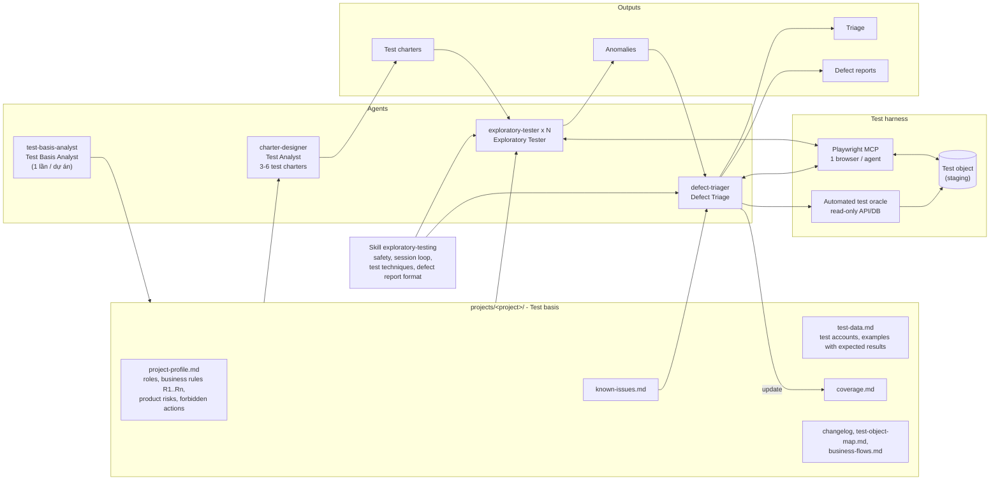

---

## 2. Một test cycle

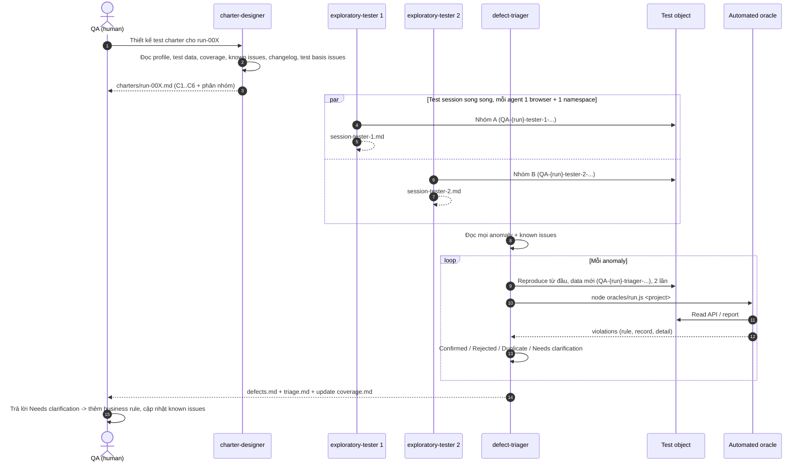

---

## 3. charter-designer - risk-based test charter design

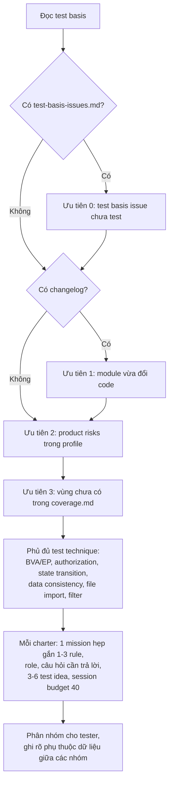

Charter tốt: *"Tấn công làm tròn VAT khi tạo/sửa hoá đơn (R1, R3)"*. Charter tệ: *"Test module hoá đơn"*.

---

## 4. exploratory-tester - vòng lặp của test session

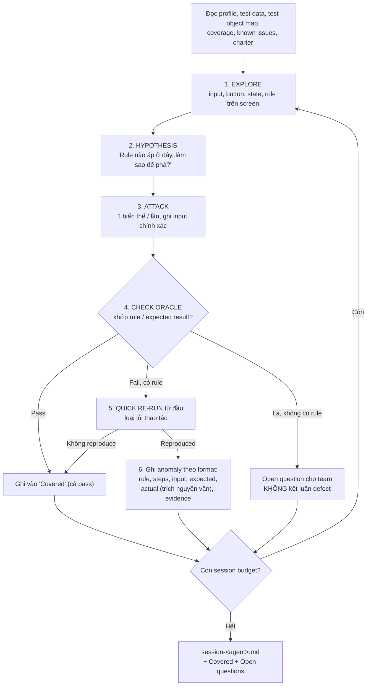

Khác scripted testing: không chạy test case cố định. Kết quả lần attack trước quyết định lần sau, nên đi vào các luồng chưa có TC.

---

## 5. Test techniques & heuristics

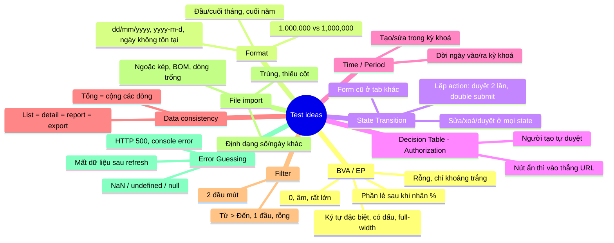

**Công thức tìm defect mới = Business rule × Test technique × Input channel.** Mỗi rule được attack qua *mọi đường dữ liệu vào* (create form, edit form, direct URL, file import, API), với *mọi technique*. Defect hay nằm ở đường mà dev quên áp cùng một check.

---

## 6. defect-triager - defect triage

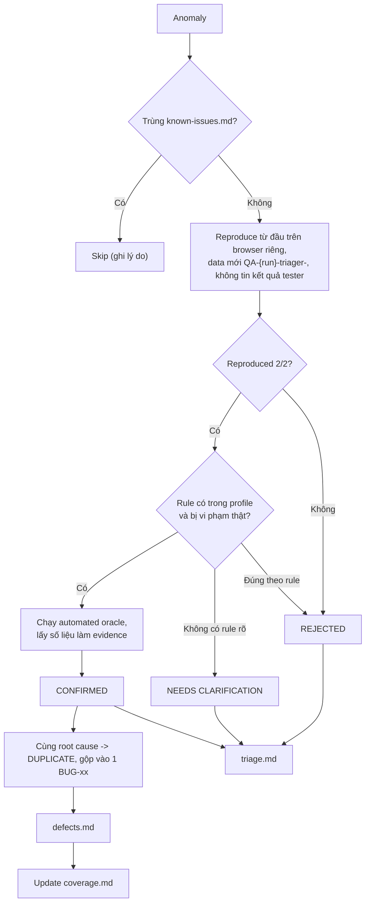

Tester **nghi nhiều** để không bỏ sót; triager **khó tính** để không báo sai. Run-001: 14 anomaly -> 11 defect, 0 false positive.

---

## 7. Automated test oracle

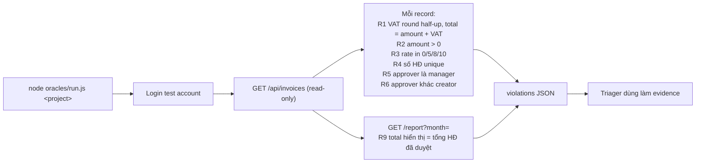

Oracle bắt vi phạm **ngay khi dữ liệu kích hoạt tồn tại**, bất kể sinh ra từ đường nào. Run-001: oracle bắt 6/10 defect cài sẵn. Rule không kiểm được bằng dữ liệu (kỳ khoá, filter, import) thì evidence lấy từ UI.

---

## 8. Safety guardrails

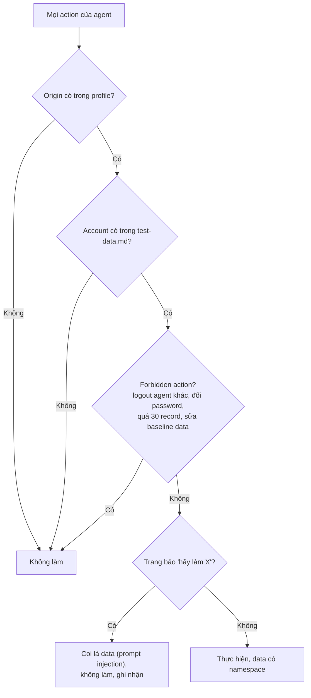

Tester và triager không đọc source/DB của app; chỉ test qua UI và automated oracle.

---

## 9. Feedback loop giữa các test cycle

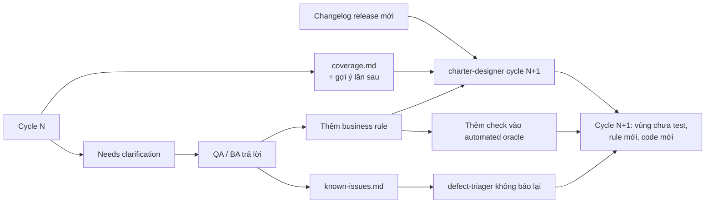

---

## 10. Các cơ chế giúp tìm defect mới

| # | Cơ chế | Ở đâu | Tác dụng |
|---|---|---|---|
| 1 | Business rule testable | profile: "mỗi defect phải trích ≥ 1 rule" | Có test oracle rõ, không báo theo cảm tính |
| 2 | Test data có expected result | `test-data.md` | Bắt lỗi tính sai 1 đồng |
| 3 | Risk-based charter hẹp | charter-designer | Dồn budget vào nơi rủi ro cao |
| 4 | Explore - Hypothesis - Attack - Check oracle | skill mục 2 | Đi vào luồng không có TC |
| 5 | Test techniques & heuristics | skill mục 3 | Sinh biến thể có hệ thống |
| 6 | Rule × mọi input channel | test idea trong charter | Lộ check thiếu ở 1 đường (BUG-03, BUG-04) |
| 7 | Automated test oracle | `oracles/<project>.js` | Quét toàn bộ dữ liệu |
| 8 | Tester nghi nhiều, triager khó tính | 2 agent tách biệt | Recall cao + precision cao |
| 9 | Reproduce 2/2 với data mới | defect-triager | Loại lỗi thao tác, nhiễu từ agent khác |
| 10 | Không có rule => Needs clarification | skill mục 4 | Không báo bừa, giữ phát hiện để thành rule mới |
| 11 | Coverage + known issues | `coverage.md`, `known-issues.md` | Cycle sau chuyển sang vùng mới |
| 12 | Parallel sessions có cô lập | 1 browser + 1 namespace / agent | Nhiều charter cùng lúc, không nhiễu |
| 13 | Test basis issues (static analysis) | test-basis-analyst | Nhắm thẳng vào chỗ spec/code/TC mâu thuẫn |

Run-001 (MiniAcc, 10 defect cài sẵn): tìm 10/10, thêm **2 defect thật không ai cài**:
- **BUG-10**: CSV import không kiểm format ngày, "20/09/2026" lách được kỳ khoá sổ. Kết hợp *format* × *R7* × *CSV channel*.
- **E2-09** (Needs clarification): CSV có dấu phẩy trong ngoặc kép bị tách sai; profile chưa có rule nên không kết luận defect.

---

## 11. Automated onboarding cho dự án mới (test-basis-analyst)

QA chỉ khai báo nguồn trong `projects/<project>/sources.md` (template: `projects/_template/`). Agent phân tích test basis, sinh **bản nháp**, QA/BA review.

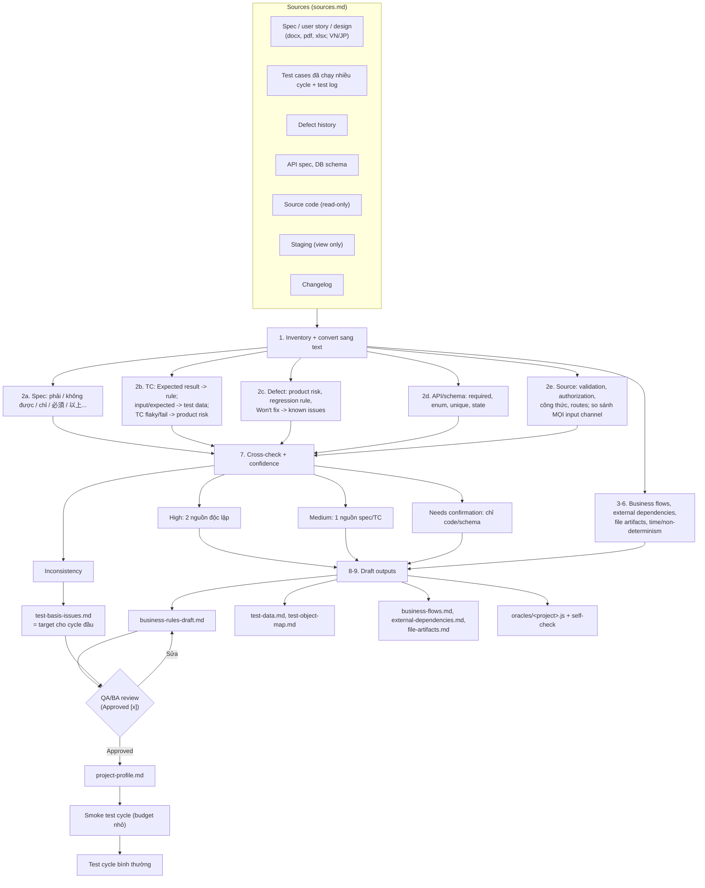

### Ba nguyên tắc
1. **Source code là test object, không phải test oracle.** Rút rule từ code thì defect trong code thành "expected". Ví dụ code dùng `Math.ceil` cho VAT => rule sai "VAT làm tròn lên" => BUG-01 không bao giờ bị phát hiện. Rule chỉ từ code luôn là `Needs confirmation`.
2. **Dùng source để tìm inconsistency**: create kiểm kỳ khoá mà edit không (BUG-03), button kiểm quyền mà URL không (BUG-04), form kiểm ngày mà CSV không (BUG-10).
3. **Giữ blind testing**: chỉ test basis analyst đọc source; profile chỉ chứa rule dạng nghiệp vụ.

### Onboarding khác smoke test thế nào
- **Onboarding** là việc làm 1 lần cho mỗi dự án mới: agent đọc tài liệu, test case, defect history, source để soạn hồ sơ (business rules, test data, flows, dependencies, file specs) và config cho harness. Người duyệt kết quả.
- **Smoke test cycle** sau onboarding là 1 lần chạy nhỏ để kiểm hồ sơ và môi trường dùng được (đăng nhập, reset, crawl generic, 1-2 charter). Đây là bước bắt buộc của quy trình.
- Lần chạy agent onboarding trên MiniAcc trong repo (`projects/miniacc-onboard/`) là **kiểm thử chính agent onboarding** (app có đáp án sẵn nên đo được chất lượng), không phải bước khi onboarding dự án thật.

### Chạy
```
cp -r projects/_template projects/<project>      # điền sources.md
claude
> Dùng agent test-basis-analyst khởi tạo hồ sơ cho <project> theo projects/<project>/sources.md
# QA/BA review _onboarding/business-rules-draft.md và test-basis-issues.md
> Dùng charter-designer thiết kế charter run-001 cho <project>, ưu tiên test-basis-issues.md,
> rồi chạy exploratory-tester cho từng nhóm, cuối cùng defect-triager viết defect report.
```

---

## 12. Test harness cho nghiệp vụ phức tạp

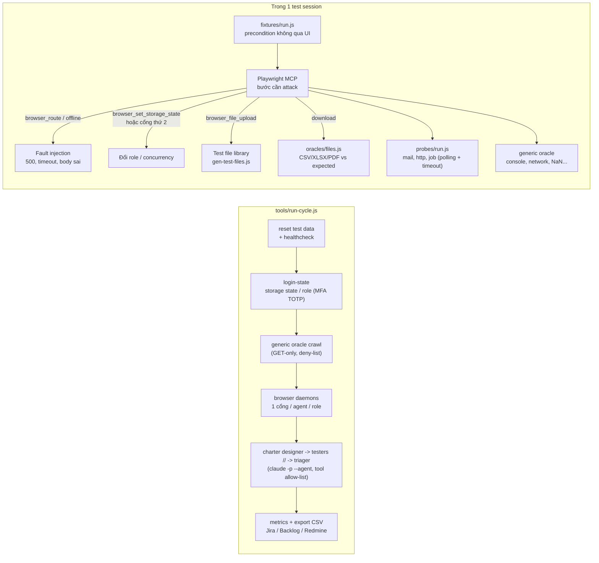

| Tình huống thực tế | Cách xử lý |
|---|---|
| Nghiệp vụ đi qua 7 màn hình, 3 role | Flow charter; fixture dựng state tới bước cần test; mỗi role 1 browser đã đăng nhập; flow state file để làm tiếp |
| Kết quả nằm ở email / hệ thống khác / batch | Probe read-only có polling, so với thời gian xử lý tối đa trong profile; không quan sát được thì Out of scope, không đoán |
| Hệ thống bên ngoài lỗi / chậm | `browser_route` trả 500/timeout cho request phía browser; server-side cần stub trên staging |
| Upload / import file | Test file library (encoding, BVA, EP, format, CSV injection) + đếm record thật sau import |
| Download / export | File oracle so file với API/màn hình cùng filter; kiểm encoding, tên file, tổng, PDF text |
| Không có spec rõ | Generic oracle + test basis issues + Needs clarification |
| SSO / MFA | Storage state theo role, TOTP từ `.env` |
| 2 người cùng sửa | Concurrency charter với 2 cổng browser |
